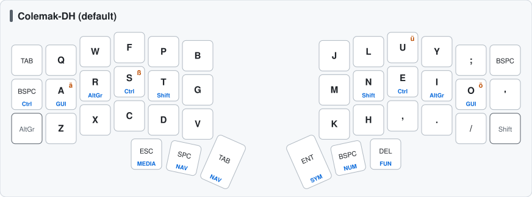
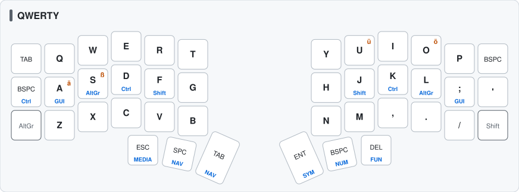
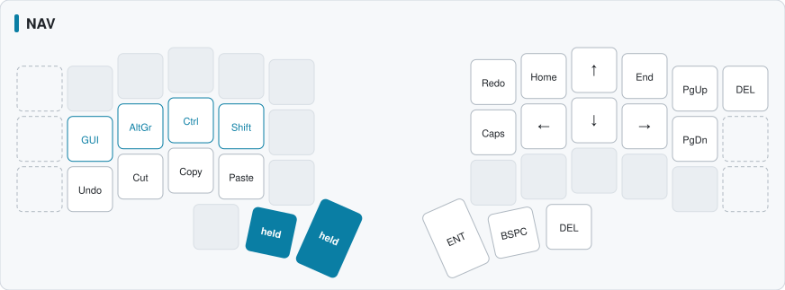
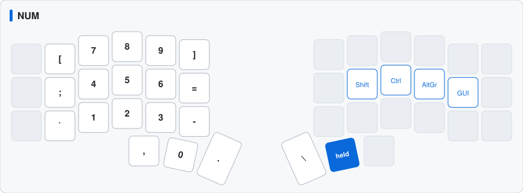
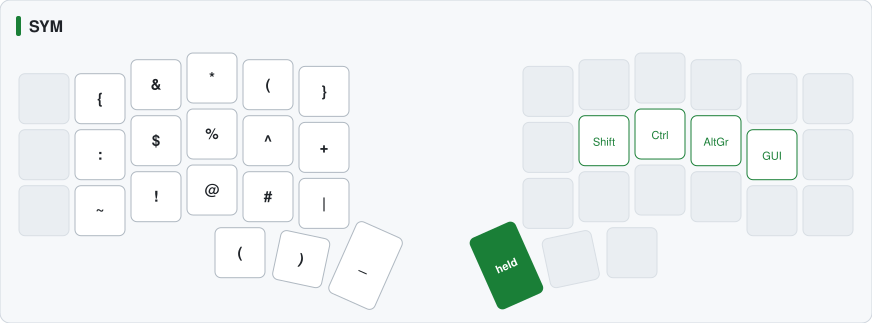
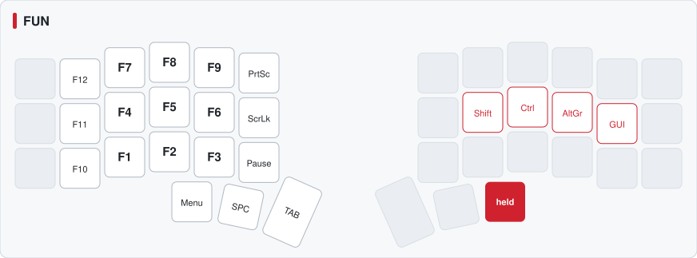
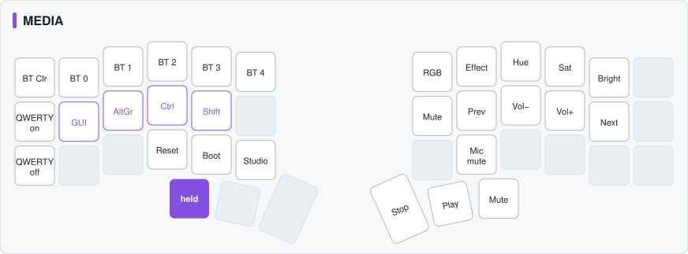

# zmk-config-corne

[ZMK](https://zmk.dev) configuration for a Corne Choc Pro with a
[Miryoku](https://github.com/manna-harbour/miryoku)-style keymap.

The keymap is made for the Windows **US-International** layout and for typing
German umlauts: holding AltGr turns `A`, `O`, `U` and `S` into `ä`, `ö`, `ü` and `ß`.

## Layers

Small blue labels are the hold function of a key, orange letters are produced with AltGr.
Dashed keys are transparent, grey keys have no function.

The graphics are generated with `python3 img/draw_layers.py`.
